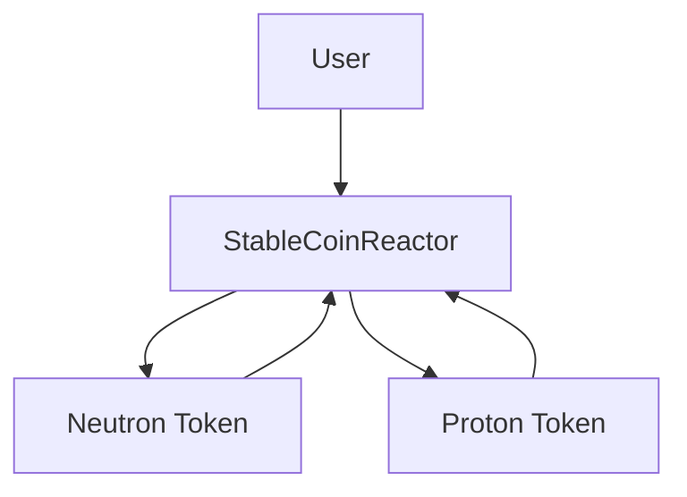
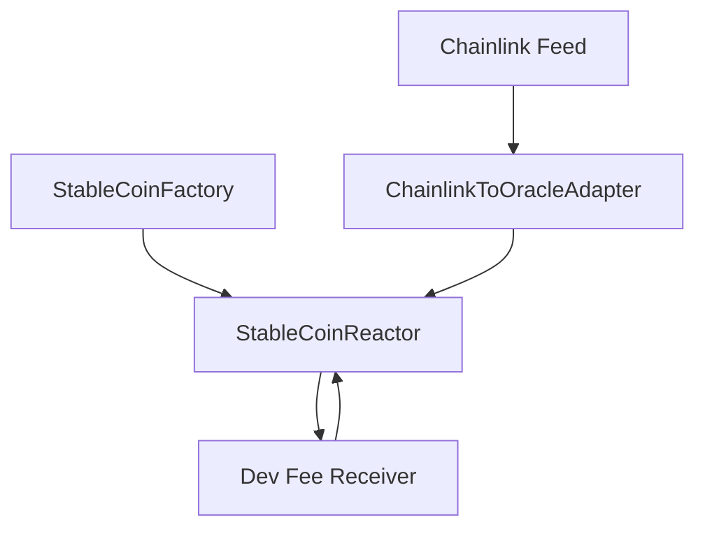

<div align="center">
  
  &nbsp;&nbsp;&nbsp;&nbsp;
  
</div>

&nbsp;

<div align="center">

# Gluon-EVM

**A modular EVM-based DeFi protocol for splitting reserve-backed value into stable and volatile assets.**

Developed under [**Stability Nexus**](https://github.com/StabilityNexus)

[](https://github.com/StabilityNexus/Gluon-EVM/actions/workflows/test.yml)
[](https://soliditylang.org/)
[](https://getfoundry.sh/)

</div>

<p align="center">
  <a href="https://t.me/StabilityNexus">
    
  </a>
  &nbsp;
  <a href="https://x.com/StabilityNexus">
    
  </a>
  &nbsp;
  <a href="https://discord.gg/YzDKeEfWtS">
    
  </a>
  &nbsp;
  <a href="https://linkedin.com/company/stability-nexus">
    
  </a>
</p>

---

## Overview

Gluon is an EVM-based DeFi smart-contract protocol built around a contract called the `StableCoinReactor`.

Each reactor is configured with:

- a reserve or base ERC-20 asset
- an `IOracle`-compatible price source
- dev authority, dev fee receiver and dev fee rate
- fission and fusion fees
- a critical reserve-ratio parameter
- metadata for the reserve, pegged asset, Proton, and Neutron tokens

Users deposit the base asset through **fission**, which creates two connected protocol assets:

- **Neutron** — the stable or pegged-side asset
- **Proton** — the volatile or residual-side asset

The reverse operation is **fusion**. Users burn the required Proton and Neutron amounts and receive the underlying base asset back.

Gluon also supports **transmutation**, allowing value to move between Proton and Neutron using the reactor's current pricing state and configurable beta-fee parameters.

> [!WARNING]
> Gluon is under active development. The contracts should be treated as experimental and are not intended for production use without further review, testing, and security assessment.

---

## Features

- **Factory-based deployment** — deploy multiple independent `StableCoinReactor` instances through `StableCoinFactory`
- **Fission** — deposit reserve assets and mint Proton and Neutron
- **Fusion** — burn Proton and Neutron and withdraw reserve assets
- **Transmutation** — convert value between Proton and Neutron
- **Generic oracle interface** — use any oracle implementation compatible with `IOracle`
- **Chainlink support** — normalize Chainlink price-feed values to 18-decimal WAD format
- **Configurable fees** — separate fission and fusion fees
- **Dynamic beta fees** — transmutation fee and decay parameters chosen at deployment and immutable afterwards
- **On-chain pricing views** — expose reserve ratio and Proton/Neutron price calculations
- **Foundry test suite** — unit and integration tests for adapters, factory deployment, and reactor flows
- **Continuous integration** — formatting, build, and test checks through GitHub Actions

---

## How It Works

### Fission

A user deposits the configured base ERC-20 asset into a reactor.

Reserve assets must expose ERC-20 decimal metadata and may use between 0 and 18 decimals. ERC-20 transfers, balances, fees, and Fission/Fusion base-asset event amounts remain in the reserve token's native units, while reactor pricing and reserve accounting normalize those amounts to 18-decimal WAD precision. The transmutation volume ledger is also WAD-normalized because it is used directly in beta-fee accounting. Reserve tokens with more than 18 decimals are rejected to avoid silent precision loss.

Within the reactor, conversion happens only where native amounts enter or leave: once when a deposit has been measured after transfer, once when a withdrawal amount is read, and once behind the accessor used for reserve reads that feed pricing and reserve-ratio calculations. Fission converts its own cached balance, because it needs the native value as the baseline for measuring the deposit. Protocol reserve, pricing, and ratio calculations use the normalized internal representation after values cross the ERC-20 boundary.

The reactor:

1. transfers the base asset from the user
2. transfers the separate dev fee to the dev fee receiver and retains the fission fee in the reserve
3. calculates the Proton and Neutron outputs
4. mints both assets to the selected recipient

Every user fission calculates the output proportionally using the existing reserve and token supplies, which are initialized during reactor deployment.

### Fusion

A user specifies an amount of the base asset to withdraw.

The reactor:

1. calculates the proportional Proton and Neutron amounts that must be burned
2. burns both tokens from the user
3. applies the configured fusion fee
4. returns the remaining base asset to the selected recipient
5. transfers the separate dev fee to the dev fee receiver; the fusion fee stays in the reserve

### Transmutation

Users can convert:

- Proton to Neutron
- Neutron to Proton

The conversion uses:

- the current reactor reserve
- Proton and Neutron token supplies
- the oracle price
- the current beta-fee parameters
- the reactor's decayed transmutation-volume state

### Oracle Pricing

Gluon reads the reserve asset price through the shared `IOracle` interface.

Oracle values are expected in **WAD format**, meaning 18 decimals.

The reactor's dimensionless `pegFactor` uses 36 decimals, with `1e36` representing
one. `adjustPeg()` applies 1% step coefficients when the reserve ratio is outside its
operating range. Downward adjustments keep it positive; upward adjustments round
up to preserve progress. Prices, fees and reserve accounting remain WAD-scaled.

The `ChainlinkToOracleAdapter`:

- reads the latest Chainlink feed value
- rejects negative values and allows zero
- scales the value to 18 decimals
- exposes the feed description
- exposes the latest update timestamp

#### Oracle Staleness

Gluon intentionally does not reject an oracle price because of its age. If an oracle
stopped updating permanently, a freshness timeout could preserve redemptions
indefinitely. Gluon accepts the risk of stale pricing rather than adding this
age-based restriction. Other operation checks still apply.

If an oracle read reverts, the reactor uses its last successfully cached price.
Nonzero prices are cached by state-changing operations only when the whole operation
completes; view calls do not update the cache. This fallback supports oracles through
the shared `IOracle` interface and does not depend on Chainlink round metadata.

Volume-dependent beta decay fees should always be enabled; an increase in a direction's recorded
volume can raise its transmutation fee, counteracting trading against a mispriced
oracle. This is a mitigation, not a guarantee of accurate pricing: opposing trades
and decay also affect the volume ledger.
Freshness timeouts should not be added as a routine oracle bug fix.

---

## Architecture

The system has two main parts:

1. the **reactor flow** for user interactions and token mint/burn logic
2. the **deployment and oracle flow** for factory deployment, pricing, and dev fee collection

### Reactor Flow



- The **user** interacts with the **StableCoinReactor**.
- During **fission**, the user deposits the base asset into the reactor.
- The reactor mints **Neutron** and **Proton** tokens.
- During **fusion** or **transmutation**, Neutron and/or Proton flow back into the reactor.

### Deployment and Oracle Flow



- `StableCoinFactory` deploys new `StableCoinReactor` instances.
- `ChainlinkToOracleAdapter` reads data from the `Chainlink Feed`.
- The adapter provides WAD-normalized oracle values to the reactor.
- The `devFeeReceiver` receives the separate dev fee.
- The `dev` can update that receiver and transfer its own role through a two-step proposal and acceptance.

### Core Contracts

| Contract | Purpose |
|---|---|
| `StableCoinFactory` | Deploys and tracks `StableCoinReactor` instances |
| `StableCoinReactor` | Holds reserves and implements fission, fusion, pricing, and transmutation |
| `Tokeon` | ERC-20 token controlled by its reactor and used for Proton and Neutron |
| `IOracle` | Shared interface for WAD-normalized oracle values |
| `ChainlinkToOracleAdapter` | Adapts a Chainlink feed to the shared oracle interface |

---

## Project Maturity

- [x] Core reactor contract implemented
- [x] Factory contract implemented
- [x] Proton and Neutron token deployment implemented
- [x] Fission and fusion implemented
- [x] Proton and Neutron transmutation implemented
- [x] Generic oracle interface implemented
- [x] Chainlink adapter implemented
- [x] Unit and integration tests included
- [x] Continuous integration configured
- [ ] Public beta deployment documented
- [ ] External security review completed
- [ ] Production deployment completed

The first public beta deployment is planned for Ethereum Sepolia.

Deployment addresses, transaction hashes, and constructor parameters should be documented after the deployment is completed.

---

## Tech Stack

| Layer | Technology |
|---|---|
| Smart Contracts | Solidity `^0.8.20` |
| Development Framework | Foundry |
| Testing | Forge |
| Contract Interaction | Cast |
| Local Development Chain | Anvil |
| Libraries | OpenZeppelin Contracts |
| CI | GitHub Actions |

---

## Repository Structure

```text
.
├── .github/
│   └── workflows/
│       └── test.yml
├── lib/
│   ├── forge-std/
│   └── openzeppelin-contracts/
├── script/
│   └── Deploy.s.sol
├── src/
│   ├── StableCoin.sol
│   ├── StableCoinFactory.sol
│   ├── interfaces/
│   │   └── IOracle.sol
│   ├── oracles/
│   │   └── ChainlinkToOracleAdapter.sol
│   └── tokens/
│       └── Tokeon.sol
├── test/
│   ├── ChainlinkAdapter.t.sol
│   ├── GenericIOracleIntegration.t.sol
│   └── GluonIntegration.t.sol
├── AGENTS.md
├── BestPracticesChecklist.md
├── CONTRIBUTING.md
├── Deployments.md
├── MAINTAINERS.md
├── .gitmodules
├── foundry.toml
└── README.md
```

---

## Getting Started

### Prerequisites

Install the following tools:

- [Git](https://git-scm.com/)
- [Foundry](https://getfoundry.sh/)

Verify the installation:

```bash
forge --version
cast --version
anvil --version
```

### Clone the Repository

```bash
git clone --recurse-submodules https://github.com/StabilityNexus/Gluon-EVM.git
cd Gluon-EVM
```

If the repository was cloned without submodules:

```bash
git submodule update --init --recursive
```

---

## Usage

### Build

```bash
forge build
```

### Run All Tests

```bash
forge test
```

### Run Tests with Verbose Output

```bash
forge test -vvv
```

### Run a Specific Test File

```bash
forge test --match-path test/ChainlinkAdapter.t.sol -vvv
```

```bash
forge test --match-path test/GluonIntegration.t.sol -vvv
```

```bash
forge test --match-path test/GenericIOracleIntegration.t.sol -vvv
```

### Run a Specific Test Function

```bash
forge test --match-test TEST_FUNCTION_NAME -vvv
```

### Format Contracts

```bash
forge fmt
```

### Check Formatting

```bash
forge fmt --check
```

### Gas Snapshot

```bash
forge snapshot
```

### Check the Git Diff

```bash
git diff --check
```

---

## Deployment

The current deployment script can deploy:

- `StableCoinFactory`
- `ChainlinkToOracleAdapter` when `CHAINLINK_FEED` is provided

The `StableCoinFactory` constructor does not require any parameters.

The factory has no owner; reactor deployment is permissionless.

The `ChainlinkToOracleAdapter` constructor requires one parameter:

```text
feedParam: address of the selected Chainlink feed contract
```

### Environment Variables

Never commit private keys, RPC credentials, or API keys.

Set the required environment variables:

```bash
export PRIVATE_KEY=YOUR_PRIVATE_KEY
export SEPOLIA_RPC_URL=YOUR_SEPOLIA_RPC_URL
export CHAINLINK_FEED=YOUR_CHAINLINK_FEED_ADDRESS
export ETHERSCAN_API_KEY=YOUR_ETHERSCAN_API_KEY
```

### Dry Run

Run the deployment script without broadcasting transactions:

```bash
forge script script/Deploy.s.sol:DeployGluon \
  --rpc-url "$SEPOLIA_RPC_URL" \
  -vvvv
```

### Broadcast to Sepolia

```bash
forge script script/Deploy.s.sol:DeployGluon \
  --rpc-url "$SEPOLIA_RPC_URL" \
  --broadcast \
  -vvvv
```

### Broadcast and Verify

```bash
forge script script/Deploy.s.sol:DeployGluon \
  --rpc-url "$SEPOLIA_RPC_URL" \
  --broadcast \
  --verify \
  --etherscan-api-key "$ETHERSCAN_API_KEY" \
  -vvvv
```

### Deployment Records

After deployment, record:

- network name
- chain ID
- deployment date
- deployed Git commit
- deployer address
- factory contract address
- Chainlink adapter address
- Chainlink feed address
- deployment transaction hashes
- constructor parameters
- block explorer links
- contract verification links
- basic smoke-test results

A recommended location is:

```text
deployments/sepolia.md
```

---

## Deploying a Reactor

`StableCoinFactory.deployReactor(...)` deploys a new `StableCoinReactor`.

Before deployment, the caller approves the factory to transfer `initialReserve`.
The factory first receives the reserve from the caller, then approves the newly deployed
reactor to use the amount actually received. The factory calls `initialFission(amountIn)`, which
uses the same internal fission path as normal user fission. The resulting Neutron and
Proton seed supplies are minted to the reactor itself and remain locked as protocol
backing. Fission and dev fees also apply during this initial fission. Seed issuance
uses `15e17`; retained fission fees increase the actual initial reserve ratio.
Initialization rejects a resulting ratio outside the operating range.

A reactor is configured with:

```text
vaultName
baseAssetName
baseAssetSymbol
peggedAssetName
peggedAssetSymbol
baseToken
oracle
protonName
protonSymbol
dev
devFee
fissionFee
fusionFee
criticalReserveRatio
initialReserve
betaPhi0
betaPhi1
decayPerSecondWad
```

### Validation Rules

The reactor validates that:

- the base token address is not zero
- the oracle address is not zero
- the oracle address contains deployed contract code
- the dev and dev fee receiver addresses are not zero
- the dev fee is below `1e18`
- each fission or fusion fee plus the dev fee is below `1e18`
- each beta fee coefficient is at most `1e18`
- the per-second volume retention multiplier is at most `1e18`
- the critical reserve ratio is at least `1e18` and below the upper reserve ratio
- the initial reserve is non-zero and can establish a valid initialized reserve state
- the vault name is not empty
- the base asset name and symbol are not empty
- the pegged asset name and symbol are not empty
- the Proton name and symbol are not empty

---

## Main Reactor Functions

### Fission

```solidity
function fission(uint256 amountIn, address to) external
```

Deposits the base asset and mints Proton and Neutron to the selected recipient.

### Fusion

```solidity
function fusion(uint256 amount, address to) external
```

Burns the proportional Proton and Neutron amounts and returns the base asset.

### Proton to Neutron Transmutation

```solidity
function transmuteProtonToNeutron(
    uint256 protonIn,
    uint256 minNeutronOut,
    address to
) external returns (uint256 neutronOut, uint256 feeWad)
```

Burns Proton and mints the corresponding Neutron amount after applying the beta fee.

### Neutron to Proton Transmutation

```solidity
function transmuteNeutronToProton(
    uint256 neutronIn,
    uint256 minProtonOut,
    address to
) external returns (uint256 protonOut, uint256 feeWad)
```

Burns Neutron and mints the corresponding Proton amount after applying the beta fee.

Both transmutations revert with `AmountTooSmall` if the minted amount is below
the caller's minimum, before burning input tokens or paying dev fees. Minimums use
raw output-token units and apply after both fees. Passing zero opts out of the
minimum; the existing zero-output check still applies. A zero-price no-op remains
available with a zero minimum, but reverts when a positive minimum is requested.

### Protocol and Dev Fees

Fission, fusion and beta fees stay in the reserve. A separate constructor-set
`devFee` is charged on the same gross amount as the operation's protocol fee.
Both fees are rounded down independently and deducted from the user's credited
value or payout; only the dev fee is transferred to `devFeeReceiver`.
This follows the separation of `f` and `fT` in
[Djed's fee calculation](https://github.com/DjedAlliance/Djed-Solidity/blob/d15e0eb55376730a4a5ea60615704b7ff5d9c98a/src/Djed.sol#L162).

Fission and fusion use native reserve-token units. Beta reactions calculate fees
on their WAD-normalized gross base value; the dev payment is converted down to
native reserve-token units. Any conversion dust stays in the reserve. Beta-plus
checks the resulting reserve ratio after the dev payment. If the combined beta
and dev fees leave no output, the transaction reverts without paying a fee.

For Gluon deployments, pass the initial dev address
`0x86B8f920835015c0F1b697dBe0B8b150a986eCE5`. The constructor initializes both
`dev` and `devFeeReceiver` to that address. The WebUI supplies a fixed
`devFee` of `1e15`, representing 0.1%.

Only `dev` can call `setDevFeeReceiver(newReceiver)`, which rejects zero addresses.
To transfer the dev role, the current dev calls `proposeDev(newDev)` and the nominee
calls `acceptDev()`. A pending proposal can be replaced; acceptance clears it.
Transferring dev does not change the fee receiver. Receiver changes and role transfers
emit events. Each operation event includes its dev fee amount in native reserve-token
units. Neither role can change the immutable fee rates,
beta parameters or oracle.

### Immutable Beta Parameters

The deployer chooses `betaPhi0`, `betaPhi1`, and `decayPerSecondWad` through the
factory when creating each reactor. The constructor validates and stores these
values as immutable configuration; neither the deployer nor the dev can
change them afterwards. There is no beta-parameter setter.

`betaPhi0` is the base transmutation fee and `betaPhi1` controls the volume-dependent
fee. Both use 18-decimal WAD units. `decayPerSecondWad` is the fraction of the volume
ledger retained each second: `1e18` means no decay, and `0` clears past volume when
at least one second has elapsed. Passing `(0, 0, 1e18)` preserves the previous
default behavior. Different reactors may choose different fixed settings.

The reactor keeps gross Proton-to-Neutron and Neutron-to-Proton volumes in separate
unsigned counters. Both decay with the configured retention multiplier. Fees use
the positive difference for the relevant direction, so opposing trades offset each
other only when calculating the fee. Each counter is rounded down separately during
decay. Transmutation events report both unsigned counters.

The factory is permissionless and has no owner. These constructor and factory
interface changes apply to new deployments; existing deployed contracts are unchanged.

---

## Price and Reserve Views

The reactor exposes view functions for inspecting its current state.

```solidity
function reserve() public view returns (uint256)
```

Returns the amount of the base asset currently held by the reactor.

```solidity
function getBasePriceInPeggedAsset() public view returns (uint256)
```

Returns the oracle price of the base asset in the pegged asset.

```solidity
function neutronPriceInBase() public view returns (uint256)
```

Returns the calculated Neutron price in the base asset.

```solidity
function protonPriceInBase() public view returns (uint256)
```

Returns the calculated Proton price in the base asset.

```solidity
function neutronPriceInPeggedAsset() external view returns (uint256)
```

Returns the calculated Neutron price in the pegged asset.

```solidity
function protonPriceInPeggedAsset() external view returns (uint256)
```

Returns the calculated Proton price in the pegged asset.

```solidity
function reserveRatioPeggedAsset() public view returns (uint256)
```

Returns the current reserve ratio using the oracle value and Neutron supply.

---

## CI

The GitHub Actions workflow runs on:

- pushes
- pull requests
- manual workflow dispatches

The workflow performs:

1. repository checkout with recursive submodules
2. Foundry installation
3. Forge version output
4. formatting validation using `forge fmt --check`
5. contract compilation using `forge build --sizes`
6. the complete test suite using `forge test -vvv`

---

## Security

This repository is under active development.

Before a production deployment, the project should complete:

- broader unit and integration test coverage
- fuzz testing
- invariant testing
- static analysis
- external contract review
- deployment verification
- documented operational procedures
- monitoring for oracle and dev fee receiver risks

To report a potential vulnerability, contact the Stability Nexus team privately through:

- [Discord](https://discord.gg/YzDKeEfWtS)
- [Telegram](https://t.me/StabilityNexus)

Do not disclose sensitive vulnerabilities through a public GitHub issue.

---

## Contributing

Contributions are welcome.

Before opening a pull request, run:

```bash
forge fmt --check
forge build
forge test
git diff --check
```

Keep each pull request focused on one improvement and include relevant tests.

---

## Maintainers, Mentors and Ideators

Project role assignments are documented in [`MAINTAINERS.md`](./MAINTAINERS.md), which is the canonical source for the current ideators, mentors, and maintainers.

---

## Contributors

Thanks to everyone contributing to Gluon-EVM.

[](https://github.com/StabilityNexus/Gluon-EVM/graphs/contributors)

---

<div align="center">

**Stability Nexus**

</div>
